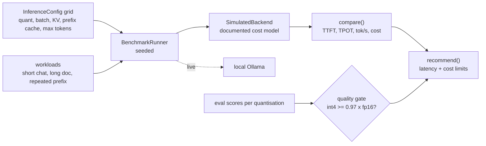

# Jagadish-inference-optimization

[](https://github.com/jagadishmazure-jpg/Jagadish-inference-optimization/actions/workflows/ci.yml)
[](https://github.com/jagadishmazure-jpg/Jagadish-inference-optimization/actions/workflows/codeql.yml)


**A lab for LLM serving trade-offs (quantisation, batching, KV cache, prefix caching, max tokens) with a benchmark grid, a comparison table and a recommendation that will not pick int4 without eval evidence. Numbers come from a documented cost model and are labelled simulated.**

> Personal learning and portfolio project. Everything runs offline on synthetic,
> fictional data with no API keys. Nothing is deployed. Numbers in this README
> come from real runs and are re-checked by CI (`scripts/render_docs.py --check`).

## Recruiter summary

- Benchmarks serving configs across three workloads and recommends the cheapest one that meets latency and cost limits, with the binding constraint named.
- Quality gate: int4 is excluded unless eval scores show it within a floor (default 0.97) of fp16. The demo shows all three cases: no evals (int8 chosen), int4 at 0.93 (excluded), int4 at 0.98 (chosen).
- Every latency and cost number is from `SimulatedBackend`, and the output says so; a live runner for a local Ollama server is included for real measurements.

## Purpose

Serving cost is mostly decided by a handful of knobs, and each one trades
something: int4 saves memory and money but can lose quality, batching raises
throughput but hurts first-token latency. I built this to practise reasoning
about those trades and to make the recommendation step refuse the classic
mistake of shipping a cheaper quantisation without checking quality.

## Architecture



## How it works

**Configs** (`inferopt/configs.py`): the knobs, validated, with warnings for
risky combinations.

**Backend** (`inferopt/costmodel.py`): a seeded cost model for time to first
token, time per output token, throughput and cost. The coefficients are
assumptions written in the module, not measurements.

**Benchmark and report** (`inferopt/benchmark.py`, `inferopt/report.py`):
runs the grid, builds the table, then `recommend()` filters by latency and
cost limits and the quality gate. Gated quantisations need a score for both
fp16 and the candidate; without one they are excluded with a reason.

**Live** (`inferopt/live.py`): the same runner against a local Ollama server
for real numbers. Guide: [docs/optimization-guide.md](docs/optimization-guide.md).

## Real code and output

```python
"""Benchmark grid -> comparison table -> quality-gated recommendation.

ALL latency, throughput and cost numbers below are from SimulatedBackend's
documented cost model, not real measurements. The quality scores are
placeholder assumptions (SIMULATED_QUALITY) standing in for your own evals.
"""
from inferopt import (
    SIMULATED_QUALITY,
    BenchmarkRunner,
    InferenceConfig,
    compare,
    long_doc,
    recommend,
    repeated_prefix,
    short_chat,
)

configs = [
    InferenceConfig(),                                   # fp16, KV cache on (normal server default)
    InferenceConfig(quantization="int8", batch_size=4),
    InferenceConfig(quantization="int4", kv_cache="on"),
]
results = BenchmarkRunner(seed=7).run_grid(configs, [short_chat(), long_doc(), repeated_prefix()])
print("SIMULATED results (cost model, not a GPU):")
print(compare(results).markdown())

print("\n1) No eval evidence supplied:")
rec = recommend(results, max_ttft_ms=500.0, max_cost_usd=0.05)
print("  pick:", rec.config.describe())
print("  binding:", rec.binding_constraint)
print("  quality check:", rec.quality_check)

print(f"\n2) Placeholder eval scores {SIMULATED_QUALITY}, floor 0.97 of fp16:")
rec = recommend(results, max_ttft_ms=500.0, max_cost_usd=0.05, quality=SIMULATED_QUALITY)
print("  pick:", rec.config.describe())
print("  excluded:", list(rec.excluded))

print("\n3) Evals show int4 within 2% of fp16:")
rec = recommend(results, max_ttft_ms=500.0, max_cost_usd=0.05,
                quality={"fp16": 0.90, "int8": 0.89, "int4": 0.885})
print("  pick:", rec.config.describe(), "|", rec.quality_check)
```

Output of `python examples/demo.py` (real run, re-checked in CI):

<!-- run: python examples/demo.py -->
```text
SIMULATED results (cost model, not a GPU):
| config | TTFT (ms) | TPOT (ms) | tok/s | cost (USD) | quality |
| --- | ---: | ---: | ---: | ---: | --- |
| int4/b1/kv:on/pc:off/mt:512 | 78.2 | 18.2 | 55.3 | 0.0174 | lossy — meaningful quality risk; do not ship without evals. |
| int8/b4/kv:on/pc:off/mt:512 | 123.2 | 27.8 | 94.3 | 0.0432 | near-baseline quality on most tasks; re-run evals to confirm. |
| fp16/b1/kv:on/pc:off/mt:512 | 163.2 | 45.2 | 22.4 | 0.0877 | baseline quality — the reference everything else is judged against. |

1) No eval evidence supplied:
  pick: int8/b4/kv:on/pc:off/mt:512
  binding: quality gate (int4/b1/kv:on/pc:off/mt:512: no int4 eval score (needs fp16 and int4))
  quality check: int8 is not gated, but has no eval score: confirm on your evals

2) Placeholder eval scores {'fp16': 1.0, 'int8': 0.99, 'int4': 0.93}, floor 0.97 of fp16:
  pick: int8/b4/kv:on/pc:off/mt:512
  excluded: ['int4/b1/kv:on/pc:off/mt:512: int4 scores 0.93 of fp16, below the 0.97 floor']

3) Evals show int4 within 2% of fp16:
  pick: int4/b1/kv:on/pc:off/mt:512 | int4 scores 0.98 of fp16 on the supplied evals
```
<!-- /run -->

## How to run

```bash
git clone https://github.com/jagadishmazure-jpg/Jagadish-inference-optimization.git
cd Jagadish-inference-optimization
python -m pip install pytest      # no runtime dependencies
python -m pytest -q          # offline, no keys
python examples/demo.py
python scripts/render_docs.py --check   # documented output still matches
```

Test suite size (real collection, re-checked in CI):

<!-- run: python scripts/count_tests.py -->
```text
33 tests collected
```
<!-- /run -->

## Guardrails

- int4 is never recommended without eval scores for fp16 and int4 that pass the floor.
- Every recommendation states the binding constraint and what was excluded and why.
- Simulated numbers are labelled as simulated in code, output and docs.

## Limitations

- All numbers in the demo are from a cost model, not a GPU; they show the method, not real performance.
- The quality scores in the demo (`SIMULATED_QUALITY`) are placeholders; real use needs your own eval run per quantisation.
- The live runner covers one local Ollama model and has no concurrency test.

## Built vs planned

| Capability | Status | Where |
|---|---|---|
| Config grid and workloads | Built | `inferopt/configs.py`, `inferopt/workloads.py` |
| Seeded simulated backend | Built | `inferopt/costmodel.py` |
| Comparison table and quality-gated recommendation | Built | `inferopt/report.py` |
| Live runner for local Ollama | Built | `inferopt/live.py` (not run in CI) |
| Measured GPU results (vLLM, TGI) | Planned | docs/implementation-guide.md |

## Threat model

| Threat | Mitigation in this repo | Status |
|---|---|---|
| Cheaper config ships with worse answers | Quality gate needs eval scores for int4 | Built |
| Simulated numbers read as real | Labelled in code, output and docs | Built |
| Latency regression after a config change | Re-run the grid in CI on real hardware | Planned |

## Interview points

- Batching raises throughput and hurts first-token latency; the table shows both.
- My review found the recommender could pick int4 on cost alone; now it needs eval evidence first.
- I label simulated numbers as simulated; the live runner exists for real ones.

More, with likely follow-up questions: [docs/interview-points.md](docs/interview-points.md).

## Implementation guide

The step-by-step path from this offline build to an Azure deployment is in
[docs/implementation-guide.md](docs/implementation-guide.md). None of it has been
run; it is a plan.

## Related repositories

| Repo | How it relates |
|---|---|
| [Jagadish-model-inference-lab](https://github.com/jagadishmazure-jpg/Jagadish-model-inference-lab) | Routing across models with cost and fallbacks |
| [Jagadish-lora-finetuning](https://github.com/jagadishmazure-jpg/Jagadish-lora-finetuning) | Fine-tuning, which interacts with quantisation |
| [Jagadish-llm-evals-observability](https://github.com/jagadishmazure-jpg/Jagadish-llm-evals-observability) | Where the quality scores would come from |
| [Jagadish-azure-finops](https://github.com/jagadishmazure-jpg/Jagadish-azure-finops) | Cost tracking for AI workloads |

## Documentation

- [Optimisation guide](docs/optimization-guide.md)
- [Implementation guide (Azure)](docs/implementation-guide.md)
- [Interview points](docs/interview-points.md)
- [Security policy](SECURITY.md)

## Project layout

```
inferopt/
  configs.py    knobs and validation
  workloads.py  synthetic workloads
  costmodel.py  SimulatedBackend
  benchmark.py  grid runner
  report.py     compare, recommend, quality gate
  live.py       local Ollama runner
examples/demo.py  the run shown above
tests/        offline pytest suite
```

## License

MIT, see [LICENSE](LICENSE). All data is synthetic; every organisation and person is fictional.
